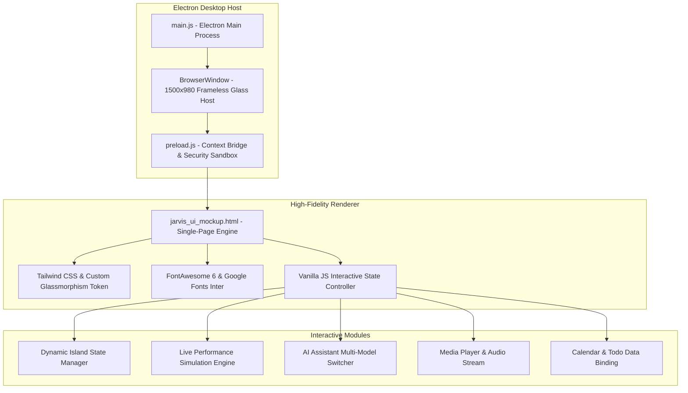

# JARVIS AI Assistant & OS UI Dashboard

<div align="center">

-blue.svg)


**Next-Generation Windows Desktop Experience featuring Adaptive Dynamic Island, Glassmorphic UI, and Multi-Model AI Assistant.**

[Unduh Rilis Terbaru](https://github.com/oddycosplay/jarvis-ai-asisten-/releases) • [Laporkan Masalah](https://github.com/oddycosplay/jarvis-ai-asisten-/issues) • [Panduan Instalasi](#-panduan-instalasi--penggunaan)

</div>

---

## 📌 Tentang Proyek (About)

**JARVIS AI Assistant & OS UI Dashboard** adalah antarmuka sistem operasi desktop generasi baru yang menggabungkan estetika *glassmorphism* modern dengan arsitektur interaktif **Dynamic Island**. Dirancang khusus untuk lingkungan desktop Windows 10 dan Windows 11, aplikasi ini membungkus pengalaman web interaktif berkinerja tinggi ke dalam aplikasi desktop native mandiri berbasis **Electron**.

Aplikasi ini menyatukan pemantauan sistem perangkat keras (*CPU, RAM, SSD*), pusat notifikasi sistem operasi, kontrol multimedia, produktivitas harian, serta asisten kecerdasan buatan (*AI Assistant*) multi-model (Google Gemini, Anthropic Claude, dan OpenAI GPT) dalam satu kesatuan antarmuka yang elegan dan responsif.

---

## ✨ Fitur Unggulan (Core Features)

### 1. Transformasi 3-Mode Dynamic Island
* **Compact Island (Mini Mascot):** Kapsul mengambang minimalis di bagian tengah atas layar yang berfungsi sebagai gerbang interaksi cepat tanpa mengganggu produktivitas desktop.
* **Contextual Island (Media Player):** Bertransformasi otomatis menjadi widget pemutar audio/lo-fi interaktif dengan tampilan cover art, timeline progress bar, dan kontrol playback.
* **Expanded Utility Panel:** Panel dashboard lengkap yang meluncur turun dari Dynamic Island saat diklik, memberikan akses ke 7 modul sistem utama.

### 2. 7 Modul Dashboard Terintegrasi
1. **Quick Controls:** Saklar interaktif untuk Wi-Fi, Bluetooth, Audio Output, Night Light, Dark Mode, serta slider volume real-time.
2. **Today & Productivity:** Jam digital adaptif dengan 3 tema warna (Default Dark, Gold Accent, Neon Glass), pengatur waktu / Pomodoro timer, kalender mingguan, dan To-Do list tersinkronisasi per tanggal.
3. **Notification & Performance Monitor:**
   - **Windows OS Notifications:** Simulasi notifikasi sistem nyata (WhatsApp, media sosial, pembaruan OS) yang dapat dihapus perorangan atau dibersihkan sekaligus (*Clear All*).
   - **Hardware Telemetry:** Pemantauan langsung persentase CPU Usage, RAM Memory (aktual vs 16GB), dan ruang bebas SSD Disk.
4. **Clipboard Manager:** Riwayat klip dengan visualisasi split-view, pengelompokan jenis data (*Text, Link, Command*), dan metadata ukuran karakter & waktu.
5. **App Launcher:** Direktori aplikasi desktop (Microsoft Office, Coding Tools, Media, Browser) dengan fitur pencarian dan filter kategori instan.
6. **Wallpaper Engine:** Preset latar belakang resolusi tinggi, integrasi folder Windows, dan input generator prompt AI.
7. **Power Controls:** Tombol aksi sistem cepat untuk *Lock*, *Sleep*, *Restart*, dan *Shut Down*.

### 3. JARVIS Multi-Model AI Assistant
* Jendela modal cerdas dengan pilihan model AI terkemuka:
  - **Google Gemini 2.5 Flash** (Default)
  - **Claude 3.5 Sonnet**
  - **GPT-4o OpenAI**
* Mendukung input teks dan perintah suara (*voice listening*).
* Akses instan menggunakan pintasan keyboard global: `Ctrl + Space` (Buka/Tutup Asisten) dan `Escape` (Tutup Semua Overlay).

---

## 🏗️ Arsitektur Sistem (System Architecture)

Aplikasi dibangun dengan arsitektur dua lapisan (*layered architecture*) yang memisahkan proses desktop native dengan lapisan presentasi antarmuka web:



### Penjelasan Komponen Arsitektur:
1. **Electron Main Process (`main.js`):** Mengelola siklus hidup jendela desktop, ukuran resolusi dasar (1500x980 dengan minimum 1200x760), `SingleInstanceLock` guna mencegah duplikasi proses, dan menyembunyikan menu bar bawaan Windows.
2. **Secure Context Isolation (`preload.js`):** Mengamankan komunikasi antara sistem operasi dan lapisan web dengan mengaktifkan `contextIsolation` dan menonaktifkan `nodeIntegration` langsung pada renderer.
3. **Renderer Layer (`jarvis_ui_mockup.html`):** Seluruh antarmuka dikembangkan dengan pendekatan *Single-File High-Performance Architecture* menggunakan utility CSS Tailwind, filter glassmorphism CSS `-webkit-backdrop-filter`, aksen warna Jarivs Gold (`#e0c278`), dan event listener DOM modular.

---

## 💻 Spesifikasi Teknis (System Specifications)

### Spesifikasi Perangkat Keras (Hardware Requirements)

| Komponen | Spesifikasi Minimum | Rekomendasi |
| :--- | :--- | :--- |
| **Sistem Operasi** | Windows 10 x64 (Build 19041+) | Windows 11 x64 (Build 22000+) |
| **Prosesor (CPU)** | Intel Core i3 / AMD Ryzen 3 (Dual-core 2.0 GHz) | Intel Core i5 / AMD Ryzen 5 ke atas |
| **Memori (RAM)** | 4 GB RAM | 8 GB RAM atau lebih |
| **Penyimpanan Bebas** | 300 MB ruang kosong pada HDD/SSD | 500 MB pada SSD |
| **Resolusi Layar** | 1280 x 720 (HD) | 1920 x 1080 (Full HD) atau lebih tinggi |

### Spesifikasi Perangkat Lunak (Software Stack)

* **Runtime:** Node.js v20.x atau v24.x LTS
* **Desktop Framework:** Electron v30.5.1 (Chromium v124)
* **Packaging Tool:** electron-builder v24.13.3
* **Styling & Icons:** Tailwind CSS Engine, FontAwesome Pro/Free v6.4, Google Fonts Inter
* **Target Arsitektur:** Windows x64 (NSIS Installer & Standalone Portable `.exe`)

---

## 🚀 Panduan Instalasi & Penggunaan

### 1. Prasyarat Lingkungan
Pastikan komputer Anda telah terinstal:
* [Node.js](https://nodejs.org/) (Versi 20.x atau terbaru)
* [Git](https://git-scm.com/)

### 2. Kloning Repositori
```bash
git clone https://github.com/oddycosplay/jarvis-ai-asisten-.git
cd jarvis-ai-asisten-
```

### 3. Menginstal Dependensi
```bash
npm install
```

### 4. Menjalankan Mode Pengembang (Development)
Untuk menjalankan aplikasi secara langsung di desktop Anda:
```bash
npm start
```
*(Atau menggunakan pintasan `npm run dev`)*

---

## 📦 Mengemas Aplikasi Menjadi Executable (.exe)

Aplikasi dapat dikompilasi menjadi paket biner Windows siap pakai:

```bash
# 1. Menghasilkan NSIS Installer (.exe) & Portable Executable sekaligus ke folder dist/
npm run dist

# 2. Menghasilkan Standalone Portable Executable saja
npm run dist:portable

# 3. Menghasilkan Unpacked Folder (cepat untuk pengujian tanpa kompresi)
npm run dist:dir
```

### Hasil Artefak Build:
* **Standalone Portable Executable:** `dist/JARVIS-OS-Portable.exe` *(Dapat langsung dijalankan tanpa proses instalasi).*
* **Setup Installer:** `dist/JARVIS-OS-1.0.2-x64.exe` *(Wizard instalasi NSIS untuk pemasangan ke direktori Program Files).*
* **Unpacked Folder:** `dist/win-unpacked/JARVIS OS.exe`

---

## ⌨️ Pintasan Keyboard Global (Hotkeys)

| Pintasan | Fungsi |
| :--- | :--- |
| `Ctrl + Space` | Membuka / Menutup Modal **JARVIS AI Assistant** |
| `Escape` | Menutup seluruh panel overlay yang sedang terbuka |
| `Click Outside` | Menutup panel expanded kembali ke mode Mini Island |

---

## 🔄 Alur Rilis CI/CD (GitHub Actions)

Repositori ini telah dilengkapi dengan automasi workflow GitHub Actions pada `.github/workflows/release.yml`. Ketika Anda membuat dan mendorong Git Tag rilis baru:

```bash
git tag v1.0.2
git push origin v1.0.2
```

Sistem GitHub Actions pada server Windows Runner akan secara otomatis:
1. Mengunduh dependensi dan memverifikasi integritas kode.
2. Mengemas aplikasi menggunakan `electron-builder` ke format installer dan portable.
3. Menerbitkan artefak `.exe` langsung ke halaman [GitHub Releases](https://github.com/oddycosplay/jarvis-ai-asisten-/releases).

---

## 📄 Lisensi (License)

Didistribusikan di bawah lisensi **MIT**. Lihat file [`LICENSE`](./LICENSE) untuk rincian ketentuan penggunaan.

---

<div align="center">
Dikembangkan dengan ❤️ oleh <b>oddycosplay</b>
</div>
